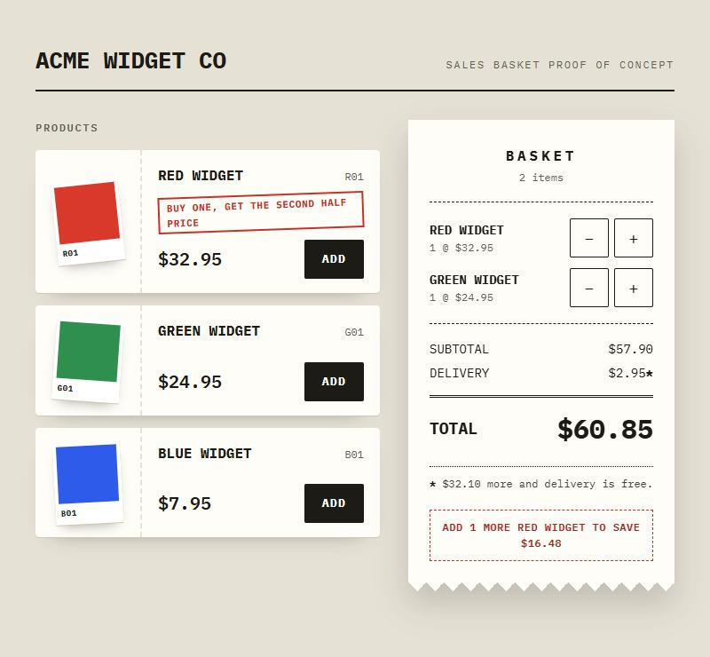
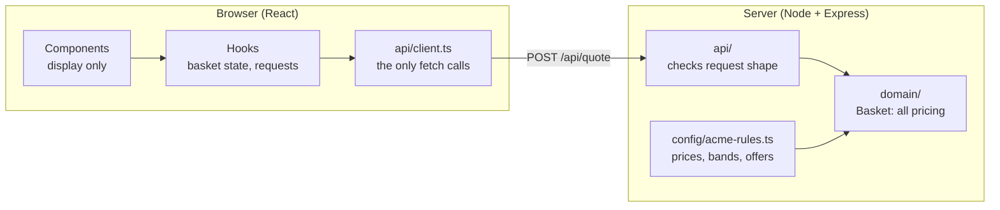

# Acme Widget Co: sales basket

A proof of concept for Acme Widget Co's new sales system. It is a shopping basket that prices widgets using a product catalogue, delivery charge rules and special offers. It is built as a Node.js + TypeScript backend and a React + TypeScript frontend.



## Contents

- [Quick start](#quick-start)
- [What it does](#what-it-does)
- [How pricing works](#how-pricing-works)
- [Assumptions](#assumptions)
- [How it is built](#how-it-is-built)
- [Using the basket in code](#using-the-basket-in-code)
- [HTTP API](#http-api)
- [Project structure](#project-structure)
- [Quality checks](#quality-checks)
- [Trade-offs](#trade-offs)

## Quick start

You need **Node.js 22.22.2+, 24.15+ or 26+** (24 is the version CI uses; see `.nvmrc`). npm comes with Node.

```bash
npm ci        # install exactly what the lockfile says
npm run dev   # start the API and the web app together
```

Open <http://localhost:5173>. The API runs on port 3000, and the web app forwards `/api` requests to it.

To run it the way it would run in production, as one server:

```bash
npm run build # compile the backend and bundle the frontend
npm start     # serve the API and the built web app on http://localhost:3000
```

| Command          | What it does                                                 |
| ---------------- | ------------------------------------------------------------ |
| `npm run dev`    | API (port 3000) and web app (port 5173) with live reload     |
| `npm run build`  | Production build of both workspaces                          |
| `npm start`      | Production server: API and web app from one origin           |
| `npm test`       | All tests, backend and frontend                              |
| `npm run check`  | Everything CI checks: formatting, lint, type check and tests |
| `npm run format` | Format every file with Prettier                              |

The server reads two optional environment variables, checked at startup:

| Variable     | Default         | Meaning                              |
| ------------ | --------------- | ------------------------------------ |
| `PORT`       | `3000`          | Port the server listens on           |
| `STATIC_DIR` | `frontend/dist` | Folder of the built web app to serve |

An invalid value, such as `PORT=abc`, stops the server with a message that names the variable.

## What it does

Acme sells three products:

| Product      | Code  | Price  |
| ------------ | ----- | ------ |
| Red Widget   | `R01` | $32.95 |
| Green Widget | `G01` | $24.95 |
| Blue Widget  | `B01` | $7.95  |

Delivery costs **$4.95** for orders under $50, **$2.95** for orders under $90, and is **free** from $90.

One offer is running: **buy one Red Widget, get the second half price.**

In the web app you add products, change quantities, and see the price breakdown update after every change. Two hints encourage a bigger order, as the brief suggests delivery pricing should:

- **Delivery footnote:** "$32.10 more and delivery is free."
- **Offer hint:** "Add 1 more Red Widget to save $16.48", shown when one more unit would trigger an offer.

When an order reaches free delivery, a "Free delivery" stamp appears on the receipt.

## How pricing works

Every basket is priced in four steps:

1. **Subtotal:** add up the full price of every unit.
2. **Discount:** each offer works out how much it takes off.
3. **Delivery:** chosen by the amount **after** the discount.
4. **Total:** subtotal − discount + delivery.

Worked example, two Red Widgets (`R01, R01`):

| Step     | Calculation                                               | Amount     |
| -------- | --------------------------------------------------------- | ---------- |
| Subtotal | $32.95 + $32.95                                           | $65.90     |
| Discount | Half of $32.95 is $16.475; the second widget costs $16.47 | −$16.48    |
| Delivery | $49.42 after the discount is under $50                    | $4.95      |
| Total    |                                                           | **$54.37** |

The four example baskets from the brief are acceptance tests (`backend/src/config/acme-rules.test.ts`), and all four pass:

| Products                  | Total  |
| ------------------------- | ------ |
| `B01, G01`                | $37.85 |
| `R01, R01`                | $54.37 |
| `R01, G01`                | $60.85 |
| `B01, B01, R01, R01, R01` | $98.27 |

## Assumptions

The brief leaves some rules open. These are the choices made, and why. Where the brief's examples decide a question, they are cited.

1. **Money is whole cents.** Every amount is an integer number of cents (`3295`, not `32.95`). Decimal numbers in JavaScript can't hold most cent values exactly (`0.1 + 0.2` is `0.30000000000000004`), so cents are converted to dollars only to display them.
2. **Half price rounds in the customer's favour.** Half of $32.95 is $16.475. The second widget costs $16.47, so the discount is $16.48. The brief's `R01, R01` total of $54.37 is only reached this way: rounding the other way gives $54.38.
3. **The offer works in pairs.** Two Red Widgets get one discount, three still get one, four get two. In the brief's last example, three Red Widgets get one discount.
4. **Delivery is charged on the amount after offers.** Charging on the full price would put `R01, R01` ($65.90) in the $2.95 band and give $52.37, not the brief's $54.37.
5. **"Under" means strictly under.** An order of exactly $50.00 pays $2.95, and exactly $90.00 is free.
6. **An empty basket costs $0**, with no delivery charge, because there is nothing to deliver.
7. **Unknown product codes are rejected, not ignored.** Silently skipping one would give a total the customer didn't expect. The API answers with a clear error instead.
8. **"How much more to spend" is measured after offers, before delivery.** It is the same amount that decides the delivery band, so the hint and the charge always agree. For `R01, G01` the total is $60.85, but the order amount is $57.90, so the footnote says $32.10 more.
9. **The basket lives in the browser.** It resets when the page is refreshed. The server keeps no state and prices whatever basket it is sent.

## How it is built



What happens when someone clicks **Add**:

1. `useBasket` updates the quantities kept in the browser, for example `{ R01: 2 }`.
2. `useRequest` sends the whole basket to `POST /api/quote` and cancels any older request that is still running, so a slow answer can never replace a newer one.
3. The server checks the request's **shape** (Zod), then builds a `Basket` with Acme's rules. The basket checks the **meaning**: does each product exist?
4. The server answers with every step of the price, and the hints, in cents.
5. The receipt displays those numbers. **The browser never calculates money**; it only formats what the server sends.

The main ideas:

- **Pricing is pure code with no framework.** `domain/` knows nothing about HTTP or Acme. It is given a catalogue, delivery bands and offers, so it can be tested with made-up data and reused for other rules.
- **Business rules are data.** Acme's prices, bands and offers live in one file, `config/acme-rules.ts`. Changing a price means editing that file only.
- **Offers are plug-ins.** Each offer is an object with a `discount(items)` function (the Strategy pattern). A new kind of offer is a new file in `domain/offers/`; `Basket` doesn't change.
- **One contract.** `api/contract.ts` holds the request and response types. The frontend imports them as types only, so a mismatch between the two sides fails the type check, and no server code reaches the browser bundle.
- **Fail fast.** Wrong rules (a price that isn't whole cents, two products with the same code, no open-ended delivery band) throw as soon as a basket is created, so a mistake shows up in tests, not in a customer's total.

## Using the basket in code

The brief asks for a basket that is created with the catalogue, delivery rules and offers, and that has `add` and `total` methods. Import paths below are relative to `backend/src`:

```ts
import { createAcmeBasket } from './config/acme-rules.js';

const basket = createAcmeBasket(); // Acme's catalogue, delivery bands and offers
basket.add('R01');
basket.add('R01');

basket.total(); // 5437, which is $54.37
basket.summary(); // { subtotal: 6590, discount: 1648, delivery: 495, total: 5437, ... }

basket.add('X99'); // throws UnknownProductError: Unknown product code: "X99"
```

With your own rules:

```ts
import { Basket, buyOneGetSecondHalfPrice } from './domain/index.js';

const basket = new Basket(
  [{ code: 'A', name: 'Thing', price: 1000 }], // catalogue, prices in cents
  [
    { below: 2000, charge: 300 }, // orders under $20 pay $3
    { below: Infinity, charge: 0 }, // everything else is free
  ],
  [buyOneGetSecondHalfPrice('A')], // offers
);
basket.add('A');
basket.total(); // 1300
```

## HTTP API

All amounts are integer cents. Every error has the same shape: `{ "error": { "code", "message" } }`. Clients should branch on `code`; the message is for people.

### `GET /api/products`

```json
{
  "products": [
    {
      "code": "R01",
      "name": "Red Widget",
      "price": 3295,
      "offerLabels": ["Buy one, get the second half price"]
    },
    { "code": "G01", "name": "Green Widget", "price": 2495, "offerLabels": [] },
    { "code": "B01", "name": "Blue Widget", "price": 795, "offerLabels": [] }
  ]
}
```

### `POST /api/quote`

Send one product code per unit:

```json
{ "items": ["R01", "G01"] }
```

Response:

```json
{
  "subtotal": 5790,
  "discount": 0,
  "delivery": 295,
  "total": 6085,
  "nextDeliveryBand": { "amountToReach": 3210, "charge": 0 },
  "offerSavings": [{ "productCode": "R01", "saving": 1648 }]
}
```

- `nextDeliveryBand`: how much more the order (after offers) needs to reach the next delivery band, and that band's charge. `null` when the basket is empty or delivery is already in the last band.
- `offerSavings`: products whose next unit an offer would make cheaper, and by how much. Empty when there are none.

### `GET /api/health`

`{ "status": "ok" }`, for load balancers and uptime checks.

### Errors

| Status | `code`            | When                                                     |
| ------ | ----------------- | -------------------------------------------------------- |
| 400    | `INVALID_REQUEST` | The body has the wrong shape, or isn't valid JSON        |
| 400    | `UNKNOWN_PRODUCT` | A product code isn't in the catalogue                    |
| 404    | `NOT_FOUND`       | No such `/api` route                                     |
| 500    | `INTERNAL_ERROR`  | Anything unexpected. Details are logged, never sent back |

For example, `{ "items": ["R01", "X99"] }` returns:

```json
{ "error": { "code": "UNKNOWN_PRODUCT", "message": "Unknown product code: \"X99\"" } }
```

## Project structure

One repository with two npm workspaces. Tests sit next to the file they test.

```text
backend/src/
  domain/              pricing rules; imports nothing from api/ or config/
    basket.ts            Basket: add(), total(), summary()
    delivery.ts          delivery bands
    money.ts             the Cents type and the whole-cents check
    offers/              one file per kind of offer
    index.ts             the domain's public API; code outside imports only this
  config/
    acme-rules.ts        Acme's catalogue, delivery bands and offers
    env.ts               environment variables, checked at startup
  api/
    contract.ts          request and response types shared with the frontend
    app.ts               Express routes
    error-handler.ts     turns every error into the one error format
  server.ts            starts the server; the only file with side effects

frontend/src/
  api/client.ts        the only file that calls fetch
  hooks/               basket state (use-basket) and requests (use-request)
  components/          display only: products, receipt, error messages
  format-cents.ts      cents to "$32.95", for display only
  styles.css           all styling, with colours and fonts as CSS variables

docs/
  screenshot.jpg       the image at the top of this README
```

## Quality checks

| Check                                                         | Tool                                                 | When it runs           |
| ------------------------------------------------------------- | ---------------------------------------------------- | ---------------------- |
| Formatting                                                    | Prettier                                             | Pre-commit hook and CI |
| Lint, including type-aware rules and the rules of React hooks | ESLint, typescript-eslint, eslint-plugin-react-hooks | Pre-commit hook and CI |
| Type check                                                    | TypeScript (strict)                                  | `npm run check` and CI |
| Tests                                                         | Vitest, Supertest, Testing Library                   | `npm run check` and CI |

The pre-commit hook (husky + lint-staged) formats and lints only the files being committed, so it stays fast. CI (GitHub Actions) runs `npm ci`, `npm run check` and `npm run build` on every push to `main` and every pull request. Hooks can be skipped with `--no-verify`; CI can't, so CI is the real gate.

What the tests cover:

- **Domain:** every pricing rule with small made-up products, so the tests check the logic, not Acme's prices.
- **Acme's rules:** the brief's four examples, and the exact $50 and $90 edges.
- **API:** every route and every error path, including that a 500 never leaks internal details.
- **Web app:** one request per basket change, an old response arriving last never overwrites a newer total, and a failed quote hides the previous total instead of leaving it on screen as if it were current.

Each important test was checked by breaking the code it protects and watching it fail.

The layout was checked from 320 px to 1440 px wide, and with totals from $148.26 up to the largest amount the money type can hold. Text meets WCAG AA contrast (totals are dimmed for a moment while a new price loads). Animations switch off for people who turn on "reduce motion" in their system settings (on Windows: Settings › Accessibility › Visual effects › Animation effects).

## Trade-offs

A few choices that shape the whole project, and what they cost:

- **Stateless server.** The browser sends the whole basket with each request, so the server needs no sessions or database. The cost: the basket is lost on refresh.
- **No data-fetching library.** One small hook (`useRequest`) covers cancellation and stale responses. TanStack Query would be the choice for a larger app.
- **Plain CSS** with custom properties. A two-panel page doesn't need Tailwind or a component library.

Left out on purpose, and each would be a next step for production: a database and accounts, a logging library, security headers and rate limiting, a Docker image, and self-hosting the font (it is loaded from Google Fonts today).
